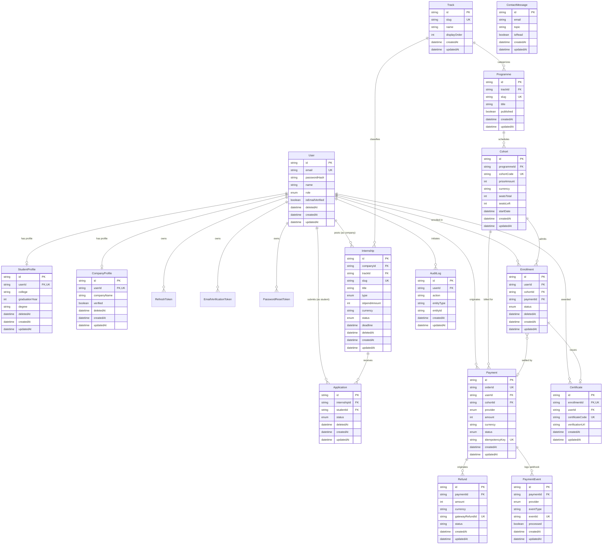

# ByteHUB Platform

Production-grade talent infrastructure connecting engineering students with vetted internships and rigorous paid training programs. Built with strict types, ACID transactional payments, and Swiss Modernist editorial design tokens.

---

## 1. Architectural Stack

- **Frontend:** Next.js 14 App Router, TypeScript (Strict), Tailwind CSS, WCAG 2.2 AA compliant.
- **Backend API:** Node.js, Express.js (Layered MVC: routes, controllers, services, repositories).
- **Validation:** Zod schemas across shared contracts, client forms, and Express request middlewares.
- **Database & Transactions:** PostgreSQL via Prisma ORM with serializable/isolated ACID transactions.
- **Payments:**
  - **Razorpay (India):** UPI, RuPay, Netbanking, Cards with HMAC-SHA256 signature verification.
  - **Stripe (Global):** 3D Secure 2, credit/debit card PaymentIntents, webhook signature validation.
  - **Idempotency:** Unique idempotency keys prevent duplicate billing or double enrollments.
- **Design Tokens:**
  - Background: Warm off-white (`#F5F2EA`)
  - Ink: Near-black (`#16150F`)
  - Accent: Editorial Vermillion (`#B8341A`)
  - Muted: Warm Charcoal (`#5A574D`)
  - Borders: Thin 1px (`#D8D3C4`)
  - Typography: Space Grotesk (headings), Inter (body), Space Mono (metadata)
  - Layout: Square corners (`rounded-none`), 8px spacing scale, high-contrast grid lines.

---

## 2. Directory Structure

```text
├── apps/
│   ├── web/                     # Next.js 14 App Router Web Application
│   │   ├── src/
│   │   │   ├── app/
│   │   │   │   ├── page.tsx                    # Route: / (Home)
│   │   │   │   ├── about/page.tsx              # Route: /about (About & Manifesto)
│   │   │   │   ├── internships/page.tsx        # Route: /internships (Directory)
│   │   │   │   ├── internships/[id]/page.tsx   # Route: /internships/:id (Detail)
│   │   │   │   ├── training/page.tsx           # Route: /training (Curriculum list)
│   │   │   │   ├── training/[id]/page.tsx      # Route: /training/:id (Detail & Checkout)
│   │   │   │   ├── for-companies/page.tsx      # Route: /for-companies (Employer portal)
│   │   │   │   ├── contact/page.tsx            # Route: /contact (Direct inquiry desk)
│   │   │   │   ├── auth/page.tsx               # Route: /auth (Login & Register)
│   │   │   │   ├── login/page.tsx              # Route: /login (Redirect to auth)
│   │   │   │   ├── signup/page.tsx             # Route: /signup (Redirect to auth)
│   │   │   │   ├── apply/[id]/page.tsx         # Route: /apply/:id (4-Step application)
│   │   │   │   ├── dashboard/student/page.tsx  # Route: /dashboard/student
│   │   │   │   ├── dashboard/company/page.tsx  # Route: /dashboard/company
│   │   │   │   └── admin/page.tsx              # Route: /admin (Supervision & Ledger)
│   │   │   ├── components/                     # Navbar, Footer, UI elements
│   │   │   └── lib/                            # api client, mockData
│   │   └── tailwind.config.ts
│   │
│   └── api/                     # Node.js + Express API
│       ├── prisma/schema.prisma # PostgreSQL Prisma schema
│       ├── src/
│       │   ├── config/          # Zod-validated environment config
│       │   ├── lib/             # Prisma client singleton
│       │   ├── middleware/      # JWT auth, RBAC, Zod validation, error handler
│       │   ├── routes/          # auth, internships, training, applications, payments, admin
│       │   ├── services/        # ACID payment fulfillment & verification
│       │   ├── app.ts           # Express application factory
│       │   └── server.ts        # Production listener
│       └── tests/               # Vitest & Supertest suite
│
├── packages/
│   └── shared/                  # Shared Zod schemas & TypeScript types
│       ├── src/
│       │   ├── schemas/         # auth, internship, training, application, payment
│       │   └── index.ts
│       └── tests/               # Schema unit tests
│
├── tsconfig.base.json           # Strict TypeScript configuration
└── package.json                 # Monorepo workspace configuration
```

---

## 3. Database Entity-Relationship (ER) Diagram



---

## 4. The 13 Required Routes

1. **Home (`/`)**: High-contrast headline, real metrics, featured roles, training tracks, comparison standard.
2. **About (`/about`)**: Editorial manifesto, engineering principles, stack architecture specification.
3. **Internships List (`/internships`)**: Search by skill/role, work arrangement filter, min stipend selector.
4. **Internship Detail (`/internships/[id]`)**: Full scope, technical requirements, stipend and perks, direct apply button.
5. **Training List (`/training`)**: Paid systems engineering cohorts, outcomes, seat countdowns, INR/USD prices.
6. **Training Detail (`/training/[id]`)**: Week-by-week syllabus deliverables, interactive Razorpay/Stripe checkout.
7. **For Companies (`/for-companies`)**: Employer value proposition, verified hiring protocol, job publishing form.
8. **Contact (`/contact`)**: Communications dispatch desk, office headquarters, PGP key.
9. **Log in / Sign up (`/auth`, `/login`, `/signup`)**: Student & company credentials onboarding with secure JWT.
10. **Application Form (`/apply/[id]`)**: 4 distinct steps:
    - *Step 1:* Personal & Academic Credentials
    - *Step 2:* GitHub, LinkedIn, Portfolio & Resume Links
    - *Step 3:* Technical Screening & Complex Project Breakdown
    - *Step 4:* Final Candidate Review & Affidavit
11. **Student Dashboard (`/dashboard/student`)**: Applications pipeline, enrolled lab progress, payment ledger.
12. **Company Dashboard (`/dashboard/company`)**: Internship listings, candidate pipeline, code dossier review.
13. **Admin Panel (`/admin`)**: Metric analytics, internship moderation, ACID transaction audit ledger, user directory.

---

## 4. Run & Test Commands

### Install dependencies
```bash
npm install
```

### Run Tests
```bash
# Run shared schemas tests & Express API tests
npm test
```

### Start Development
```bash
# Terminal 1: Backend Express API (port 5000)
npm run dev:api

# Terminal 2: Next.js Frontend (port 3000)
npm run dev:web
```

### Typecheck & Build
```bash
npm run typecheck
npm run build
```

---

## 5. Security & Accessibility Invariants

- **WCAG 2.2 AA Contrast:** All text passes 4.5:1 ratio against `#F5F2EA`.
- **Keyboard Navigation:** Explicit `:focus-visible` ring on interactive elements.
- **Server Validation:** Every mutation route validates against Zod schemas; client is never trusted.
- **ACID Transactions:** Payments, seat decrements, and student enrollments commit atomically in `prisma.$transaction`.
- **Zero Secrets in Code:** Environment secrets strictly parsed via `env.ts`.


---

## 6. Email Deliverability & Domain Authentication (SPF, DKIM, DMARC)

To guarantee that transactional emails (tax receipts, password resets, enrolment confirmations, and application updates) land in student inboxes and never in spam folders, the sending domain must be configured with SPF, DKIM, and DMARC DNS records.

### 1. Sender Policy Framework (SPF)
Add a `TXT` record on your apex domain (`bytehub.dev`):
```dns
Type:  TXT
Host:  @
Value: v=spf1 include:resend.com ~all
```
*(If using Amazon SES, substitute `include:amazonses.com ~all`; if SendGrid, `include:sendgrid.net ~all`)*

### 2. DomainKeys Identified Mail (DKIM)
DKIM signs outgoing emails with a 2048-bit cryptographic key, proving they were not altered in transit.
Add the `CNAME` records provided by your email provider:
```dns
Type:  CNAME
Host:  resend._domainkey.bytehub.dev
Value: dkim.resend.com

Type:  CNAME
Host:  resend2._domainkey.bytehub.dev
Value: dkim2.resend.com
```

### 3. Domain-based Message Authentication, Reporting & Conformance (DMARC)
DMARC instructs receiving mail servers (Google Workspace, Outlook 365, Apple Mail) how to handle messages that fail SPF or DKIM alignment, and reports spoofing attempts back to ByteHUB.
Add a `TXT` record under the `_dmarc` subdomain:
```dns
Type:  TXT
Host:  _dmarc.bytehub.dev
Value: v=DMARC1; p=quarantine; rua=mailto:dmarc-reports@bytehub.dev; ruf=mailto:dmarc-forensics@bytehub.dev; pct=100; sp=reject; aspf=r; adkim=r
```
- `p=quarantine`: Delivers failing emails to spam while warming up domain reputation; transition to `p=reject` after 30 days of clean alignment.
- `aspf=r` & `adkim=r`: Relaxed alignment allowing subdomains (e.g., `mail.bytehub.dev` or `admissions@bytehub.dev`).
- `rua`: Aggregate XML reporting URI for deliverability monitoring.

### 4. Unsubscribe Handling (RFC 8058 & CAN-SPAM / GDPR Compliance)
- **Essential Transactional Emails** (Password resets, payment receipts, cohort confirmations, verification links) are non-promotional and exempt from mandatory unsubscribe links under CAN-SPAM and GDPR. They strictly omit unsubscribe links to guarantee critical delivery.
- **Non-Essential Digests** (Weekly role alerts, tech digests) include both visible footer unsubscribe links and RFC 8058 compliant `List-Unsubscribe: <https://bytehub.dev/api/auth/unsubscribe?token=...>` headers enabling one-click unsubscribe in mail clients.

---

## 7. Production Operations Runbook

This runbook defines standard operating procedures (SOPs) for deployment, emergency rollback, zero-downtime secret rotation, failed webhook incident remediation, and financial refund processing.

### 7.1 Deploy Runbook

#### A. Staging Deployment (Continuous Delivery on Merge)
Every pull request merged into `main` automatically triggers `.github/workflows/ci-cd.yml`:
1. **Automated Quality Gate**: Runs `pnpm audit`, Gitleaks secret scan, `eslint`, `tsc --noEmit`, and the 66-test suite.
2. **Multi-Stage Container Builds**: Packages unprivileged, non-root Docker images for API and Web.
3. **Database Migration**: Executes `prisma migrate deploy` against the managed staging database.
4. **Health Check Assertion**: Probes `https://staging-api.bytehub.internal/api/health` verifying 200 OK and database connectivity before concluding.

#### B. Production Deployment (Manual Approval Gate on Tagged Release)
Production releases require a semver Git tag (`v*.*.*`) and approval by authorized release engineers:
```bash
# 1. Draft release tag from clean main branch
git tag -a v1.2.0 -m "Release v1.2.0: payment idempotency and applicant pipeline"
git push origin v1.2.0

# 2. Monitor GitHub Actions CI/CD pipeline
# Navigate to: https://github.com/bytehub/bytehub/actions
# 3. Reviewer signs off in the "production" Environment gate in GitHub UI.
# 4. Pipeline automatically executes zero-downtime rolling container cutover and notifies Sentry.
```

---

### 7.2 Emergency Rollback Procedure

If a production defect escapes into release, execute the following steps within 5 minutes:

#### Step 1: Instant Container Traffic Rollback
Revert the container deployment to the previous stable digest or Git tag:
```bash
# Via Kubernetes / AWS ECS CLI:
aws ecs update-service \
  --cluster bytehub-prod \
  --service api \
  --task-definition bytehub-api:PREVIOUS_STABLE_VERSION \
  --force-new-deployment

aws ecs update-service \
  --cluster bytehub-prod \
  --service web \
  --task-definition bytehub-web:PREVIOUS_STABLE_VERSION \
  --force-new-deployment
```

#### Step 2: Database Schema Rollback (Expand & Contract Pattern)
Because all ByteHUB migrations strictly follow the **Expand & Contract** principle:
- Phase 1 migrations **never** drop or rename existing columns.
- Reverting the application container image immediately restores healthy service without requiring emergency SQL surgery.
- If a new column constraint or index needs cleanup, run:
```bash
bash scripts/rollback-db.sh <FAILED_MIGRATION_NAME>
```

#### Step 3: Health Verification
Confirm the restored deployment is serving traffic:
```bash
curl -f https://api.bytehub.dev/api/health
```

---

### 7.3 Secret Rotation Runbook (Zero-Downtime Dual-Key Protocol)

#### A. Rotating `JWT_SECRET`
To rotate session signing secrets without invalidating active student and employer sessions:
1. Update API configuration to support dual verification:
   - Primary Key: New secret (used for signing new JWT tokens).
   - Secondary Key: Old secret (accepted for verifying unexpired tokens during the 7-day grace window).
2. Deploy the updated environment variable to the production cluster.
3. After 7 days (the expiry duration), remove the legacy key from secrets manager.

#### B. Rotating Database Credentials (`DATABASE_URL`)
1. Create a secondary PostgreSQL user with identical role permissions in RDS/Supabase.
2. Test connection with the secondary credentials.
3. Update `DATABASE_URL` in AWS Secrets Manager / Doppler.
4. Trigger a rolling restart of the API container cluster (`aws ecs update-service --force-new-deployment`).
5. Verify zero errors on `/api/health`.
6. Terminate the deprecated database user account.

#### C. Rotating Razorpay & Stripe Webhook Secrets
1. Generate a new webhook signing secret in the Razorpay / Stripe merchant dashboard.
2. Both gateways allow configuring multiple active webhook endpoints during rotation.
3. Add the new webhook secret to `RAZORPAY_WEBHOOK_SECRET` / `STRIPE_WEBHOOK_SECRET`.
4. Deploy the updated secret.
5. Deactivate the old webhook endpoint in the provider dashboard.

---

### 7.4 Handling a Failed Webhook Incident

When payment webhook alerts trigger (e.g., PagerDuty alert or Sentry exception):

```bash
# 1. Inspect recent failed webhook deliveries
# Razorpay: Dashboard > Settings > Webhooks > Select Webhook > View Logs
# Stripe: Dashboard > Developers > Webhooks > Select Endpoint > Failed Events
```

#### Diagnostic Flow:
1. **HMAC Signature Mismatch (`WEBHOOK_FORGERY` / 401)**:
   - Check if webhook payload was parsed before raw body buffer was captured. Express must use `verify: (req, res, buf) => { req.rawBody = buf; }`.
   - Verify that `STRIPE_WEBHOOK_SECRET` matches the active signing key for that endpoint.
2. **Timeout / 500 Error**:
   - The webhook event is automatically placed into the BullMQ Dead-Letter Queue (`DLQ`).
   - Query the DLQ via Admin API:
     ```bash
     curl -H "Authorization: Bearer $ADMIN_JWT" \
       https://api.bytehub.dev/api/admin/queues/dead-letter
     ```
3. **Replay from DLQ**:
   - Replay the failed job once downstream database connectivity is restored:
     ```bash
     curl -X POST -H "Authorization: Bearer $ADMIN_JWT" \
       https://api.bytehub.dev/api/admin/queues/replay/job_id_123
     ```
4. **Manual Payment Reconciliation**:
   - If provider reports `payment.captured` but student enrollment is missing:
     ```bash
     # Run manual reconciliation tool
     pnpm --filter @bytehub/api tsx scripts/reconcile-payment.ts --orderId="order_rzp_12345"
     ```

---

### 7.5 Payment Refund Processing Runbook

Refunds can be initiated via the ByteHUB Admin Panel (`/admin`) or directly via API.

#### Policy Invariants:
1. Refunds are executed inside a Prisma ACID transaction.
2. For full (100%) refunds, the student's cohort seat count is incremented (`seatsRemaining + 1`).
3. GST tax adjustments and credit note metadata are generated.
4. Transactional confirmation email is dispatched to the student.

#### CLI Refund Execution:
```bash
# Execute refund via authenticated admin CLI
curl -X POST https://api.bytehub.dev/api/admin/payments/refund \
  -H "Authorization: Bearer $ADMIN_JWT" \
  -H "Content-Type: application/json" \
  -d '{
    "paymentId": "pay_live_rzp_987654",
    "amountInPaise": 2499900,
    "reason": "Student requested cohort withdrawal prior to program kickoff.",
    "refundSeats": true
  }'
```

#### Verification:
1. Confirm payment status transitions to `REFUNDED` in the database.
2. Confirm the audit ledger records the administrator's ID and mandatory reason string.
3. Verify the cohort remaining seats count is updated.

